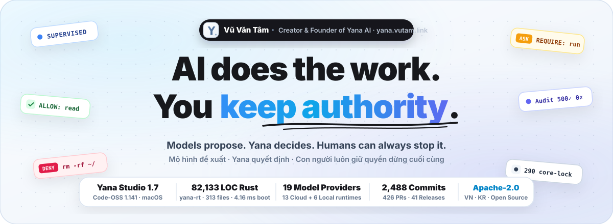
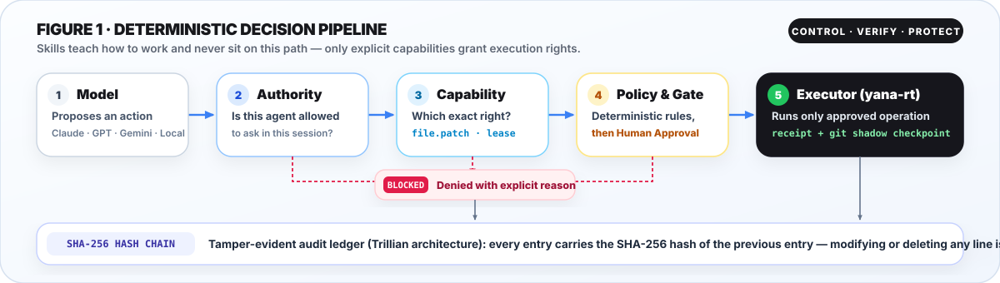
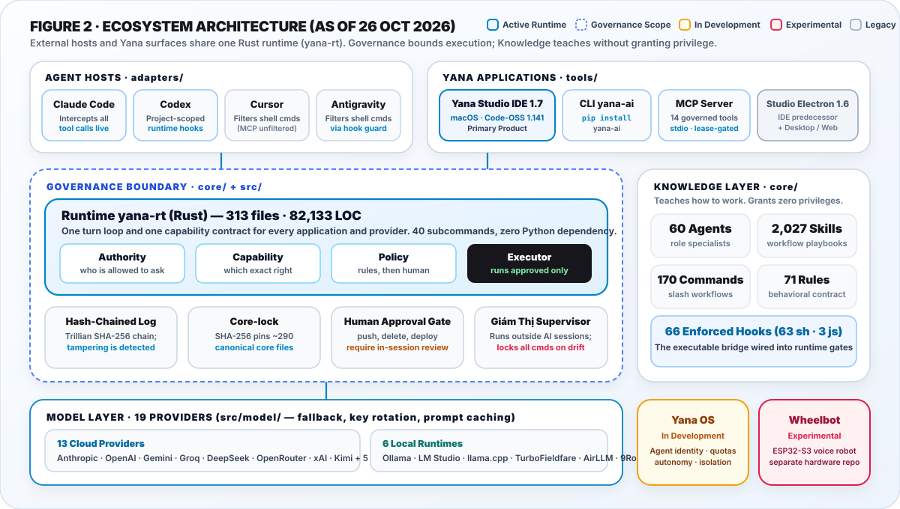

<p align="center">
  
</p>

<p align="center">
  <a href="https://yana.vutam.link"><strong>yana.vutam.link</strong></a> ·
  <a href="https://github.com/yanacuti1121/Yana-AI"><strong>Yana AI Repository</strong></a> ·
  <a href="https://github.com/yanacuti1121/Yana-AI/releases">Yana Studio IDE 1.7</a> ·
  <a href="https://crates.io/crates/yana-rt"><code>yana-rt</code> (Rust)</a> ·
  <a href="https://pypi.org/project/yana-ai/"><code>yana-ai</code> (PyPI)</a>
</p>

<p align="center">
  <a href="https://github.com/yanacuti1121/Yana-AI/actions/workflows/ci.yml"></a>
  <a href="https://crates.io/crates/yana-rt"></a>
  <a href="https://pypi.org/project/yana-ai/"></a>
  <a href="https://github.com/yanacuti1121/Yana-AI/blob/main/LICENSE"></a>
</p>

---

## Vũ Văn Tâm — Creator & Founder of Yana AI

I am a Vietnamese systems builder based in South Korea. I started building the system that became **Yana AI** at age 17 on a personal computer—with no funding, no engineering team, and no research lab—driven by a single question: **how do we let coding agents work on a real machine without handing them unchecked execution power?**

Today’s coding agents can wipe directories, push code to shared remotes, or read API keys with a single command. Telling a model *"please be careful"* inside a prompt is not a security boundary—prompts are text the model reads and can ignore. Running everything inside a sealed sandbox is safe, but strips the agent of its ability to work directly on your real project and toolchain.

**Yana AI takes the third path:** keep the agent working on your real machine, but route every action through a deterministic local control layer outside the model. Skills teach an agent *how* to work and grant zero privileges; execution power comes strictly from explicit capabilities, deterministic policy, and human approval.

> **“Models propose. Yana decides. Humans can always stop it.”**  
> *“Mô hình đề xuất, Yana quyết định, con người luôn dừng được.”*

| At a glance | |
|---|---|
| **Author & Founder** | **Vũ Văn Tâm** (Vietnamese developer in South Korea; solo builder for the first 6 months) |
| **Team update** | **Nguyễn Nam Long** joined as a new member in late October 2026 |
| **Primary product** | **Yana Studio IDE 1.7** (macOS Apple Silicon, built on Code-OSS 1.141) + **`yana-rt`** Rust runtime |
| **Scale (17 May – 26 Oct 2026)** | **2,488 commits** · **426 merged PRs** · **41 releases** · **72 tags** · **82,133 lines of Rust** across 313 files |
| **License & Website** | Apache-2.0 · [yana.vutam.link](https://yana.vutam.link/) · [github.com/yanacuti1121/Yana-AI](https://github.com/yanacuti1121/Yana-AI) |

---

## Architecture & Deterministic Control

Every request—whether originating from Claude, GPT, Gemini, DeepSeek, or a local model—passes through the exact same **5-step decision pipeline**. Both allowed and blocked actions are recorded into a tamper-evident SHA-256 hash-chained audit log inspired by Google Trillian.

<p align="center">
  
</p>

### Ecosystem Overview

External AI coding hosts (`adapters/`) and Yana’s own applications (`tools/`) converge on a single native Rust binary, **`yana-rt`**. The governance layer wraps the runtime, while the knowledge layer sits alongside it—providing specialist playbooks without granting execution privileges.

<p align="center">
  
</p>

### Repository Anatomy (Verified 26 Oct 2026)

```text
Yana-AI/
├── src/                        yana-rt Rust runtime · 313 Rust files · 82,133 LOC · 40 subcommands
│   ├── capability/             unified capability contract & executor shared across chat and MCP
│   ├── guard/                  shell-aware destructive command, pipe-to-shell, and write-mode guard
│   ├── model/                  19 providers (13 cloud, 6 local), automatic fallback, API key rotation
│   ├── session_db/             SQLite session store, full-text search, shadow-git undo checkpoints
│   ├── os/                     Yana OS: agent identity, autonomy tiers, quotas, health supervision
│   ├── mcp.rs, mcp_client/, lsp_client/
│   └── chat/, mission/, memory/, doctor/, scanner/, … (50 top-level modules)
├── core/                       governance & non-privileged knowledge layer
│   ├── hooks/                  66 runtime hooks intercepting tool calls (63 shell, 3 JavaScript)
│   ├── rules/                  71 rules · behavioral contracts & enforced policies
│   ├── agents/                 60 specialist role agents
│   ├── skills/                 2,027 workflow skills (teach how to work; grant zero privilege)
│   ├── commands/               170 slash commands
│   ├── gates/, scripts/        deterministic verification gates & 138 operational scripts
│   └── config/core-lock.json   SHA-256 cryptographic pins across ~290 canonical core files
├── tools/                      end-user applications
│   ├── yana-ide/               Yana Studio IDE 1.7 overlay built on Code-OSS 1.141
│   ├── yana-studio/            predecessor standalone Electron Studio (v1.5–1.6)
│   └── yana-desktop/, yana-web/, yana-pixel-bridge/, codexmate/, moss-tts-nano/
├── adapters/                   Claude Code, Codex, Cursor, and Antigravity integrations
└── site/, docs/, ci/, gates/, memory/ (L1 long-term & L2 session memory)
```

---

## Real-World Execution & Guard Behavior

### Component Status Matrix

| Component | Role & Scope | Status |
|---|---|---|
| **Yana Studio IDE 1.7** | Primary product (released 16 Oct 2026 for macOS). Full Code-OSS 1.141 with Copilot/MS telemetry removed and Yana wired in: supervised agent chat, approval cards, evidence-backed tasks, 19 model providers, project memory, isolated Design Canvas, and office document tools. | **Active (Production)** |
| **Runtime `yana-rt`** | Single native Rust binary: turn loop, capability contract, SQLite session store, shadow-git undo checkpoints, 14-tool MCP server/client, and read-only LSP client. | **Active (Production)** |
| **Governance & Audit** | Capability manifests, human approval gates, Trillian-style SHA-256 hash-chained log, `core-lock` (~290 files), capability leases, and decision receipts. | **Active (Production)** |
| **Giám Thị Supervisor** | Out-of-band OS daemon (`launchd` / `systemd` / Task Scheduler) running outside every AI session; locks all execution if control files drift from human-approved state. | **Active (Auto-enabled)** |
| **Host Adapters** | Claude Code (full tool-call interception), Codex (project hooks), Cursor & Antigravity (shell command filtering). | **Active (Host-dependent)** |
| **Knowledge Layer** | 60 specialist agents, 2,027 skills, 170 slash commands, and 71 rules. | **Active** |
| **Yana OS** | Local agent identity, autonomy tiers, quotas, durable action queue, and quarantine isolation. | **In Development** |
| **Wheelbot** | Voice-controlled ESP32-S3 hardware robot bridged to Yana voice tools (separate repository). | **Experimental** |

### Live Guard Examples (`yana-rt guard destructive`)

When an agent attempts to run a shell command, `yana-rt` parses shell quoting, command substitutions, heredocs, pipelines, and subshells before evaluating risk (`exit 2` = blocked, `exit 0` = allowed):

| Command Proposed by Agent | Verdict | Guard Explanation Returned to Agent & Logged |
|---|---|---|
| `curl -fsSL https://example.com/install.sh \| bash` | **Blocked (`exit 2`)** | Downloaded content is piped directly into a shell without inspection. Download to a file, inspect it first, or request human approval. |
| `rm -rf ~/Documents` | **Blocked (`exit 2`)** | Recursive forced deletion is irreversible. Target a specific path or request human approval. |
| `chmod 777 deploy.sh` | **Blocked (`exit 2`)** | Grants world-writable permissions. Use the narrowest sufficient mode such as `755` or `644`. |
| `git status --short` | **Allowed (`exit 0`)** | Read-only inspection command; no approval required. |

### Quick Start

```bash
# Python CLI & repository governance hooks
pip install yana-ai
yana-ai install      # wire Yana hooks and rules into your repository
yana-ai doctor .     # verify runtime, hooks, core-lock, and adapter health

# Native Rust runtime (zero Python dependency)
cargo install yana-rt
```

Or download **Yana Studio IDE 1.7** (`.dmg` / `.zip` for macOS Apple Silicon) directly from [yana.vutam.link](https://yana.vutam.link/) or [GitHub Releases](https://github.com/yanacuti1121/Yana-AI/releases).

---

## Six Months of Engineering (17 May – 26 Oct 2026)

| Period | Commits | Milestone | Key Engineering Deliverables |
|---|---:|---|---|
| **May 2026** *(from 17/05)* | **483** | **Foundation** | Truth Gate preventing premature "done" claims; two-tier memory (L1/L2); SHA-256 hash-chained log; OWASP LLM Top 10 guardrails; 70+ rules; MCP integration; Rust runtime rewrite; Apache-2.0 license. |
| **June 2026** | **740** | **Expansion & Surface** | Skill library ingestion; trilingual site (VI/EN/KO); 1-click GitHub App on Marketplace; client-side AES-256-GCM API key encryption; parallel subagents; OCR; Rule 68 (privacy) & Rule 69 (anti-hype). |
| **July 2026** | **246** | **Consolidation & Control** | **Giám Thị** out-of-band supervisor (16/07); `yana chat` with approval-gated tools; download malware scanner; `/freeze` scope lock; Codex adapter; Kimi provider; patched a real RCE chain in project scripts. |
| **August 2026** | **437** | **Yana OS & Capabilities** | Unified Rust workspace; Yana OS (identity, autonomy tiers, durable action queue, health); capability leases, decision receipts, remote approval protocol; Sứ Giả release freshness; ESP32 voice bridge. |
| **September 2026** | **307** | **Studio & Model Layer** | Standalone Electron Studio v1.5–1.6 (macOS/Win/Linux); provider fallback, key rotation, prompt cache markers; SQLite session store with shadow-git checkpoints; `file.patch`, `web.search`, `browser.fetch`. |
| **October 2026** *(to 26/10)* | **275** | **Closing the Loop** | MCP client + trust store; read-only LSP; plan mode & diff preview; Word/Excel/PPT/PDF/Typst office suite; `~/.yana` installer; **Yana Studio IDE 1.7** on Code-OSS 1.141 (16/10); Antigravity hook guard; 2026 website. |

---

## Performance & Honest Limitations

### Benchmark (`yana-rt` 1.5.1 Release on MacBook Air M4, 16 GB)

| Measurement | `yana-rt` (Rust) | Legacy Python | Notes |
|---|---:|---:|---|
| **Cold startup** | **4.16 ms** | — | Mean over 100 runs |
| **`yana-rt doctor`** | **143 ms** | 415 ms | **2.9× faster**, identical 16 health checks |
| **`yana-rt ci check`** | **5.8 ms** | 33 ms | **5.7× faster**, identical 5 warnings |
| **Scan `core/skills`** | **0.55 s** | 8.47 s | **15.5× faster** |
| **Destructive command guard** | **4.9 ms** | — | Per tool-call hook invocation |
| **Release binary size** | **18.2 MiB** | — | Self-contained native binary |

### Known Limitations (Published Openly)

Every safety claim in Yana comes with its explicit boundary:

1. **Audit Log Deletion:** The SHA-256 hash chain detects any in-place modification or line deletion, but cannot prevent an attacker with local filesystem write access from deleting the entire log file.
2. **`core-lock` & Giám Thị Window:** `core-lock` proves file trees match pinned hashes, not that a human reviewed the diff. Giám Thị runs out-of-band via OS schedulers every 6 hours, leaving a window of up to 6 hours before scheduled drift lock triggers.
3. **Rules vs. Enforced Hooks:** Most files in `core/rules/` describe behavioral contracts applied by the agent; only rules wired to the **66 hooks** in `core/hooks/` are deterministically enforced at runtime.
4. **Guard vs. Sandbox:** The destructive command guard is a shell-aware structural blocklist (backed by 1,642 unit tests across 6 adversarial review rounds), not an OS kernel sandbox. True protection rests on human approval gates and per-operation capability leases.
5. **Host Coverage:** Cursor does not filter MCP tool calls; Antigravity filters shell commands only and is bypassed if launched with `--dangerously-skip-permissions`.
6. **macOS Notarization:** Yana Studio IDE 1.7 is not yet Apple-notarized (pending an Apple Developer account), so first launch requires bypassing Gatekeeper (`docs/MACOS_INSTALL.md`).

---

## Seven Engineering Principles

1. **Humans before automation** *(Con người trước tự động hóa)* — Every consequential decision must have an accountable human.
2. **Safety before speed** *(An toàn trước tốc độ)* — When forced to choose, choose safety.
3. **Evidence before confidence** *(Bằng chứng trước sự tự tin)* — Claims require logs, audits, or deterministic tests.
4. **Build less, build better** *(Xây ít hơn, xây tốt hơn)* — Every feature must justify its existence; the rest is removed.
5. **Design for failure** *(Thiết kế cho thất bại)* — Every real incident becomes a stronger architectural boundary.
6. **Open, honest, transparent** *(Mở, trung thực, minh bạch)* — Build in public and document limitations alongside features.
7. **Relentless improvement** *(Không ngừng cải thiện)* — Software is never finished; wrong assumptions are more dangerous than bugs.

---

## Contact & Links

| Channel | Link |
|---|---|
| **Official Website** | [yana.vutam.link](https://yana.vutam.link/) |
| **Main Repository** | [github.com/yanacuti1121/Yana-AI](https://github.com/yanacuti1121/Yana-AI) |
| **Personal Site** | [me.vutam.link](https://me.vutam.link) |
| **Email** | [phamlongh230@gmail.com](mailto:phamlongh230@gmail.com) |
| **Social** | [TikTok (@.yana018)](https://www.tiktok.com/@.yana018) · [Facebook (vutam1810)](https://www.facebook.com/vutam1810) |

<p align="center">
  <strong>“Yana AI exists because the human remains the final decision-maker.”</strong><br />
  <sub>Vũ Văn Tâm — Creator &amp; Founder of Yana AI</sub>
</p>
