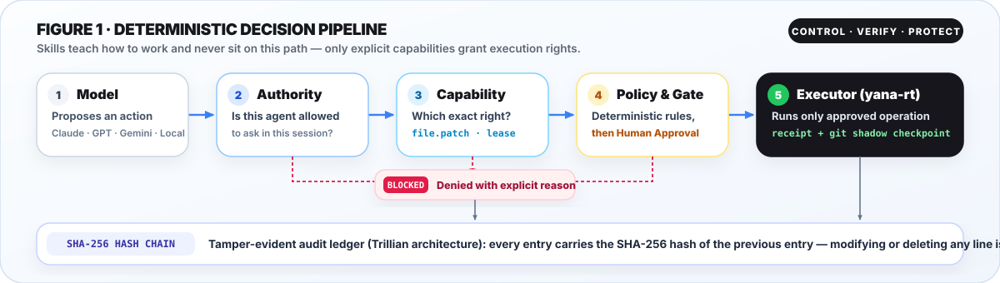
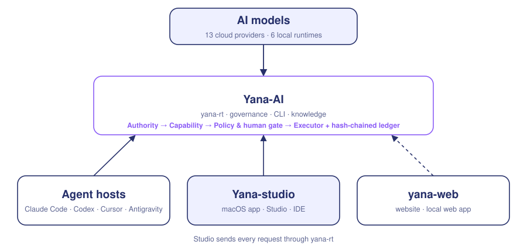

<p align="center">
  
</p>

<p align="center">
  <a href="https://yana.vutam.link"><strong>yana.vutam.link</strong></a> ·
  <a href="https://github.com/Horonomos-laps/Yana-AI">Yana-AI</a> ·
  <a href="https://github.com/Horonomos-laps/Yana-studio">Yana-studio</a> ·
  <a href="https://github.com/Horonomos-laps/yana-web">yana-web</a> ·
  <a href="https://yana.vutam.link/whitepaper.html">Technical report</a>
</p>

<p align="center">
  <a href="https://github.com/Horonomos-laps/Yana-AI/actions/workflows/ci.yml"></a>
  <a href="https://crates.io/crates/yana-rt"></a>
  <a href="https://pypi.org/project/yana-ai/"></a>
  <a href="https://github.com/Horonomos-laps/Yana-AI/blob/main/LICENSE"></a>
</p>

<p align="center">
  <a href="https://github.com/Horonomos-laps/Yana-studio/releases/latest"></a>
  <a href="https://github.com/Horonomos-laps/Yana-studio/actions/workflows/js-tests.yml"></a>
  
  
  <a href="LICENSE"></a>
</p>

<p align="center">
  <a href="https://github.com/Horonomos-laps/Yana-AI"></a>
  <a href="https://github.com/Horonomos-laps/yana-web"></a>
  
</p>

<p align="center">
  <a href="#download">Download</a> ·
  <a href="#the-apps">The apps</a> ·
  <a href="#build-from-source">Build</a> ·
  <a href="#status">Status</a> ·
  <a href="https://yana.vutam.link">Website</a>
</p>

<p align="center">
  <sub>
    <a href="https://github.com/Horonomos-laps/Yana-AI/blob/main/CODE_OF_CONDUCT.md">Code of conduct</a> ·
    <a href="https://github.com/Horonomos-laps/Yana-AI/blob/main/CONTRIBUTING.md">Contributing</a> ·
    <a href="LICENSE">Apache-2.0 license</a> ·
    <a href="https://github.com/Horonomos-laps/Yana-AI/blob/main/SECURITY.md">Security policy</a>
  </sub>
</p>

## Hi, I'm Vũ Văn Tâm 🐰

I'm a Vietnamese developer based in South Korea. I started building **Yana AI** at 17, on a personal laptop, with no funding and no team, around one question: **how can a coding agent work on a real machine without being handed unchecked power?**

A prompt that says *"please be careful"* is not a security boundary. A sealed sandbox is safe, but it cuts the agent off from your real project. Yana takes a third path: the agent works on your machine, and every action goes through a deterministic local layer **outside the model**. Skills teach an agent how to work and grant nothing. Permission comes only from explicit capabilities, policy, and a human who can say no.

> **Models propose. Yana decides. Humans can always stop it.**

<p align="center">
  
</p>

## What's here

Yana lives in three repositories under the [**Horonomos-laps**](https://github.com/Horonomos-laps) organization.

| Repository | What it holds |
|---|---|
| [**Yana-AI**](https://github.com/Horonomos-laps/Yana-AI) | The Rust runtime `yana-rt`, the governance layer, the `yana-ai` CLI, agents and skills |
| [**Yana-studio**](https://github.com/Horonomos-laps/Yana-studio) | Yana for macOS, Yana Studio, and Yana IDE |
| [**yana-web**](https://github.com/Horonomos-laps/yana-web) | The website and a local web app |

<p align="center">
  
</p>

## Where it stands (16 Nov 2026)

- **Yana 1.0** for macOS (Apple Silicon) was released on 11 Nov. It is signed ad hoc and not yet notarized, so the first launch needs a Gatekeeper bypass. [Download](https://github.com/Horonomos-laps/Yana-studio/releases/latest)
- **`yana-rt` 1.5.4** is the current runtime, on [crates.io](https://crates.io/crates/yana-rt) and [PyPI](https://pypi.org/project/yana-ai/).
- **2,633 commits** and **496 merged pull requests** (551 opened) in Yana-AI since 17 May 2026.
- 19 model providers, 100 specialist agents, 2,035 skills, 66 hooks, 71 rules.

```bash
pip install yana-ai
yana-ai install      # add Yana's hooks and rules to your repo
yana-ai doctor .     # check the runtime, hooks and core-lock

cargo install yana-rt    # the native runtime, no Python needed
```

## Honest limits

Studio is not yet at full parity with the previous desktop app. The command guard is a shell-aware blocklist, not an OS sandbox, and it does not stop `chmod 777`, so the real protection is the approval gate. Rules that no hook enforces are guidance the agent follows by choice. The [technical report](https://yana.vutam.link/whitepaper.html) lists these and the rest, with how each was measured.

## Principles

Humans before automation · Safety before speed · Evidence before confidence · Build less, build better · Design for failure · Open and honest · Never stop improving.

## Contact

[Website](https://yana.vutam.link) · [Personal site](https://me.vutam.link) · [phamlongh230@gmail.com](mailto:phamlongh230@gmail.com) · [TikTok](https://www.tiktok.com/@.yana018) · [Facebook](https://www.facebook.com/vutam1810)

<p align="center">
  <sub><strong>Yana AI exists because the human remains the final decision-maker.</strong></sub>
</p>
